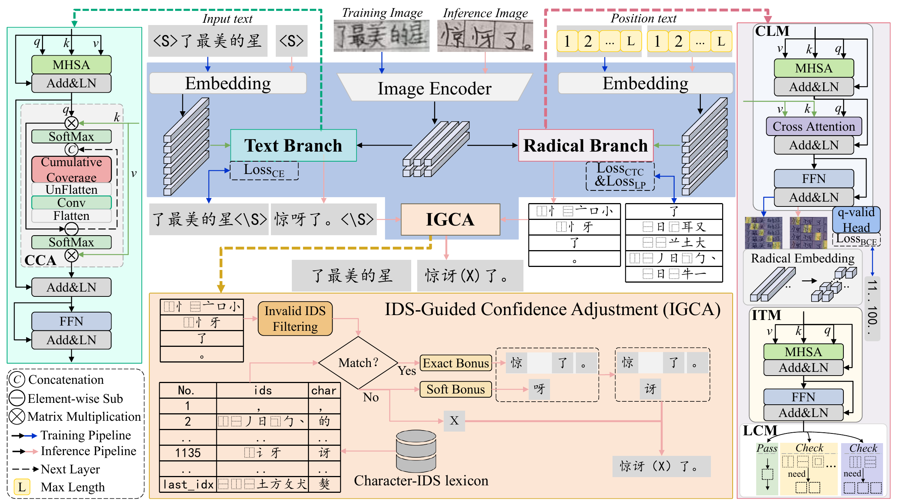

# DTRNet: Dual Text-Radical Decoding for Handwritten Chinese Text Recognition with Faked Character Detection

Official implementation of our [ACM Multimedia 2026 paper](https://arxiv.org/abs/2608.05848)( [Best Paper Award](https://2026.acmmm.org/site/awards.html) ).

## Overview

DTRNet recognizes handwritten Chinese text lines and detects **faked characters**: malformed characters that do not exist in a standard Chinese dictionary. It produces a text transcription and character-wise Ideographic Description Sequences (IDS).

The text branch transcribes the line, while the radical branch predicts IDS for structural verification against a Character-IDS lexicon. Faked characters are marked as **`X`**. IDS-Guided Confidence Adjustment (IGCA) uses the structural predictions to refine text recognition.



## Installation

The example below uses Python 3.8 and PyTorch 2.4.1 with CUDA 11.8.

```bash
git clone https://github.com/BNU-ERC-ITEA/DTRNet.git
cd DTRNet

conda create -n dtrnet python=3.8 -y
conda activate dtrnet
pip install -r requirements.txt
```

## Dataset

We reconstruct [Visual-C3](https://github.com/THUKElab/Visual-C3) into **49,337 normal training lines**, **5,482 normal test lines** and **4,370 test lines containing faked characters**. Training uses only normal text.

Download the processed data from [Baidu Netdisk](https://pan.baidu.com/s/1eb68gHWDQifwiWgIV0fQ7g?pwd=knut) ( Password : `knut`).

Extract `DTRNet_dataset.zip` to the repository root:

```text
dataset/
├── train_lmdb/
└── test_lmdb/
    ├── test_correct/
    └── test_fakedv2/
```

Each directory contains `data.mdb` and `lock.mdb`. The character and IDS dictionaries are included in `tools/utils/dict/visual_c3_ids/`.

## Quick Start

Run the following commands from the repository root.

### 1. Train

```bash
CUDA_VISIBLE_DEVICES=0,1 torchrun --nproc_per_node=2 tools/train_rec.py -c configs_new_visualC3_textline/rec/dtrnet/DTRNet.yml
```

### 2. Evaluate

Download the pretrained weights (`best.pth`) from [Baidu Netdisk](https://pan.baidu.com/s/13bQaCtEcM6JOvHdkMDIfjw?pwd=sfwv) ( Password: `sfwv`). Place the file at `outputs/DTRNet_final/best.pth`.

Before evaluation, set `constrained_ctc_decode` and `use_ids_bonus` to `true` in the configuration file.

```bash
CUDA_VISIBLE_DEVICES=0 python tools/eval_rec_textline_triple.py -c configs_new_visualC3_textline/rec/dtrnet/DTRNet.yml
```

## Citation

If you use DTRNet in your research, please cite the ACM Multimedia 2026 paper.

```bibtex
@inproceedings{10.1145/3767308.3835569,
  author = {Li, Runrui and Zhu, Lin and Huang, Hua},
  title = {DTRNet: Dual Text-Radical Decoding for Handwritten Chinese Text Recognition with Faked Character Detection},
  year = {2026},
  isbn = {9798400722134},
  publisher = {Association for Computing Machinery},
  address = {New York, NY, USA},
  url = {https://doi.org/10.1145/3767308.3835569},
  doi = {10.1145/3767308.3835569},
  booktitle = {Proceedings of the 34th ACM International Conference on Multimedia},
  pages = {5154--5163},
  numpages = {10},
  keywords = {optical character recognition, handwritten chinese text recognition, faked character detection, k-12 education.},
  location = {Rio de Janeiro, Brazil},
  series = {MM '26}
}
```

The arXiv preprint is also available.

```bibtex
@article{li2026dtrnet,
  title={DTRNet: Dual Text-Radical Decoding for Handwritten Chinese Text Recognition with Faked Character Detection},
  author={Li, Runrui and Zhu, Lin and Huang, Hua},
  journal={arXiv preprint arXiv:2608.05848},
  year={2026}
}
```

## Acknowledgements

Thanks to [OpenOCR](https://github.com/Topdu/OpenOCR) for the codebase and [Visual-C3](https://github.com/THUKElab/Visual-C3) for the dataset.
